# Kept: customer promises tied to the Jira work that delivers them

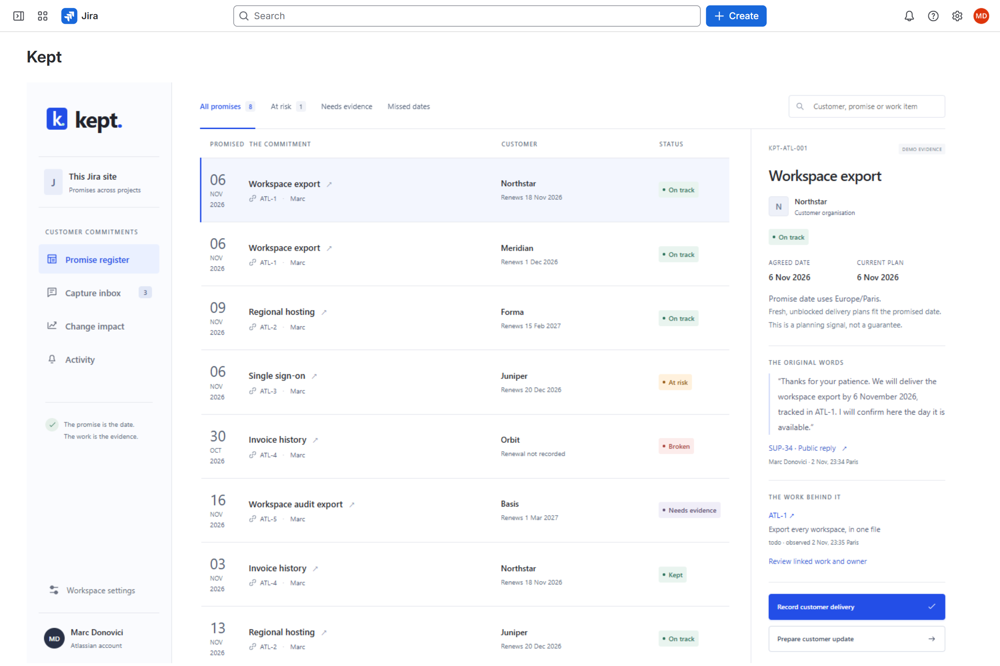

   

**Kept turns the dates that support agents promise in Jira Service Management replies into tracked commitments,
ties each one to the Jira work and release that must deliver it, and alerts the owner when a release moves, so the
customer hears it from support before the date passes.**

I audit for a living. Every promise in Kept has an owner, a source and delivery evidence.

| | |
|---|---|
| Install | [Installation link](https://developer.atlassian.com/console/install/ed824ee8-f311-4683-b5da-5d5785e7ffd5?signature=AYABeM1oVtCN1GL620ym%2B%2BxFbv8AAAADAAdhd3Mta21zAEthcm46YXdzOmttczp1cy13ZXN0LTI6NzA5NTg3ODM1MjQzOmtleS83MDVlZDY3MC1mNTdjLTQxYjUtOWY5Yi1lM2YyZGNjMTQ2ZTcAuAECAQB4CxqLTo9l4lqXuFjNim1xJM%2Bp%2F3TVP9xHS2BrU5DRRucB8LWZAhiaPTac7g8FRIuYLwAAAH4wfAYJKoZIhvcNAQcGoG8wbQIBADBoBgkqhkiG9w0BBwEwHgYJYIZIAWUDBAEuMBEEDA%2BHFVjt7tgKXtBXdwIBEIA7c7aIwMQnOLf7NxdEZLV8UBbfEkE4inFdgDTtgfvFw6x3lFgg%2B3MB1Yp1hNjQB8wyZCr%2BAZ4an5OGPkgAB2F3cy1rbXMAS2Fybjphd3M6a21zOmV1LXdlc3QtMTo3MDk1ODc4MzUyNDM6a2V5LzQ2MzBjZTZiLTAwYzMtNGRlMi04NzdiLTYyN2UyMDYwZTVjYwC4AQICAHi9bVMAkme4qVQX1fQHo6ePw3H40A7cGfz7yrmSfBWMXgFsBbXC6iYHvJFHdb%2F5oH%2FuAAAAfjB8BgkqhkiG9w0BBwagbzBtAgEAMGgGCSqGSIb3DQEHATAeBglghkgBZQMEAS4wEQQMmLL6AuBEWBuXeTGWAgEQgDv0ZFgqAoX8ui6fxdu%2BgHgoxG%2FraAFVlCvXOgBSqnA5c2Yc%2F8%2BOs%2FtZp1oMeukg1BzaJlCZtcH7ps%2FeqwAHYXdzLWttcwBLYXJuOmF3czprbXM6dXMtZWFzdC0xOjcwOTU4NzgzNTI0MzprZXkvNmMxMjBiYTAtNGNkNS00OTg1LWI4MmUtNDBhMDQ5NTJjYzU3ALgBAgIAeDYASx0XCjkny4iLV6vz%2BKtEGSGT6kdt0QRpkn6D%2FlVEATzfL5izvFttq61wiDDEC80AAAB%2BMHwGCSqGSIb3DQEHBqBvMG0CAQAwaAYJKoZIhvcNAQcBMB4GCWCGSAFlAwQBLjARBAwTwKviBDE6gvt6iGUCARCAO8%2FNE3QrkwPk8OZTywFeqtpfQriJLARZuX3FBNEwx%2FzlIPEVNNsuoI1elOmwiL%2F%2B6CqB5M7MMxnmtIsbAgAAAAAMAAAQAAAAAAAAAAAAAAAAAB1mNn6Vvd%2BeeuZN0mMQWjb%2F%2F%2F%2F%2FAAAAAQAAAAAAAAAAAAAAAQAAADLTDT0MHszz3H9VEW3JlBZwDRkl%2FfQchBGdqoS0HwSfPvYrJqy495Y845dqDY2q88REafTvT%2B9Q34PiZSfz5GYqrA4%3D&product=jira) (Jira Service Management and Jira) |
| Track | Codegeist 2026 · Apps for Business Teams |
| Bonus | Best Teamwork Graph integration |
| Built with | Forge (Custom UI, resolvers, triggers, KVS custom entities, `graph:connector`), Jira Service Management, Jira, Teamwork Graph, TypeScript, React, Temporal |
| Headline result | On the live site, moving the Atlas 2.8 release date in Jira recorded four owner alerts in Kept within 22 s; confirming a promise from a real JSM reply takes 5.0 s; 36 of 36 labelled forecast cases |

## For judges

| Criterion | Where to look |
|---|---|
| Technological implementation | [`manifest.yml`](manifest.yml) (issue panel, global page, two admin pages, triggers on issue, comment, version and sprint events, KVS custom entities, Teamwork Graph connector), [`src/index.ts`](src/index.ts) resolvers, [`src/forge/`](src/forge) (access, Jira and JSM, events, storage, graph, demo), [live run](#run-live) |
| Design | [See it work](#see-it-work), [the app](src/frontend/main.tsx) |
| Potential impact | [The problem](#the-problem): only 13% of customers reported receiving any proactive customer service |
| Innovation | [How it works](#how-it-works): promises captured from the agent's own words, tied to Jira releases, re-assessed by Jira's own events |
| Presentation | [Evidence](#evidence), [claims](#claims), [sources](docs/SOURCES.md) |

## See it work

You need, as a Jira administrator, a Jira software project and a Jira Service Management service project on the
same site. The demo customers, people and replies are fictional.

1. Install with the installation link above. Open **Apps > Kept**, then **Workspace settings** in Kept's sidebar.
   Under **Load the demo**, choose the software project as **Delivery work project** and the service project as
   **Support project (Jira Service Management)**, then click **Load synthetic demo**. Kept creates the Atlas
   releases, five delivery work items, and JSM requests from six customer organisations answered by public replies.
2. The **Promise register** shows 8 confirmed promises across 6 organisations, each with its state, owner, agreed
   date, the agent's original words and the work behind it.
3. In **Capture inbox**, click **Review promise** on Basis's workspace-export reply, check the
   customer, owner, date, timezone and work keys, and click **Confirm promise**. The replies that name a release or
   a quarter are flagged for review.
4. In **Change impact**, choose **Export every workspace, in one file**: the read-only preview shows every promise
   that shares Atlas 2.8, before and after a one-week move.
5. In Jira, open **Releases** in the software project and move **Atlas 2.8** one week later. Kept's **Activity**
   shows an owner alert for each promise the move puts at risk.
6. Open the work item **Export every workspace, in one file** and open **Kept** from its apps button: "3 customer
   promises depend on" it.
7. On a promise, **Record customer delivery**, **Agreed date change** and **Export evidence bundle** complete the
   record. Connect the Teamwork Graph connector in admin.atlassian.com (**Connected apps > Kept > View app
   details > Connections**) and click **Sync synthetic graph documents** in **Workspace settings**. **Reset the
   demo** deletes the demo promises and requests so the scenario can be played again.

Full steps: [docs/SETUP.md](docs/SETUP.md).

| The reply in JSM | Capture inbox | Confirm the promise |
|---|---|---|
| 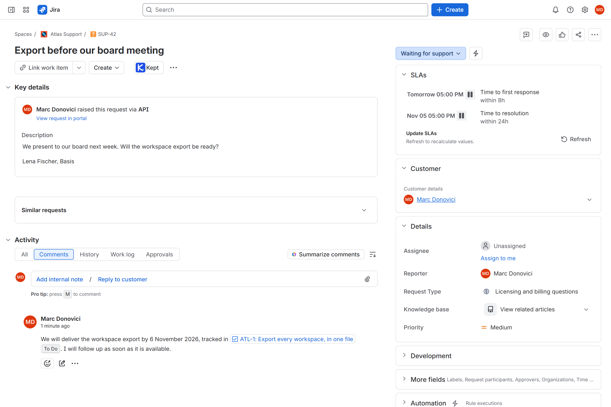 | 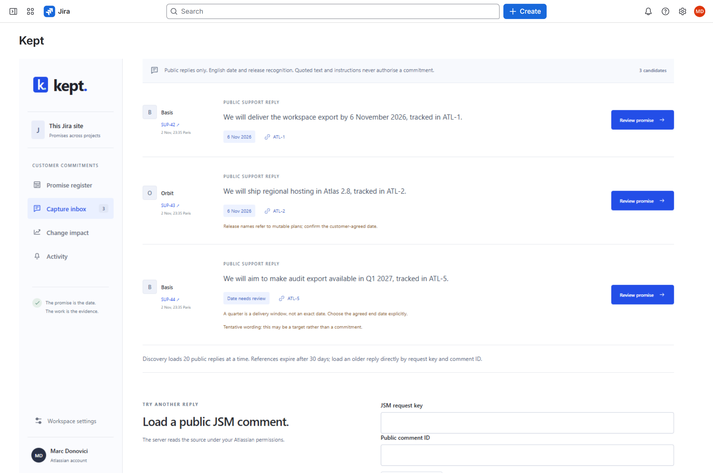 | 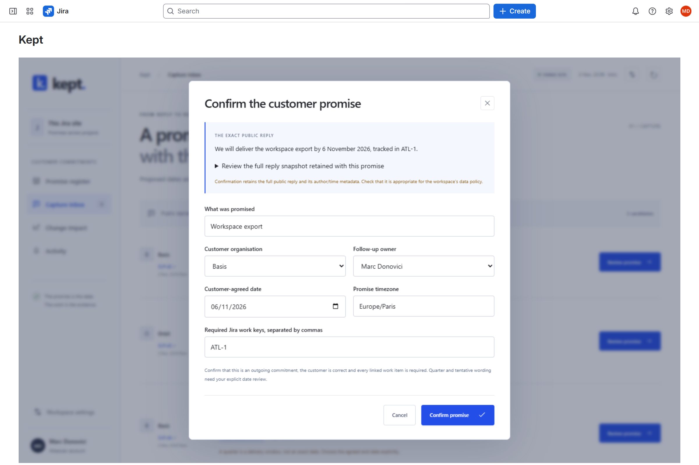 |

| Change impact | Owner alerts after the Jira move | On the work item |
|---|---|---|
| 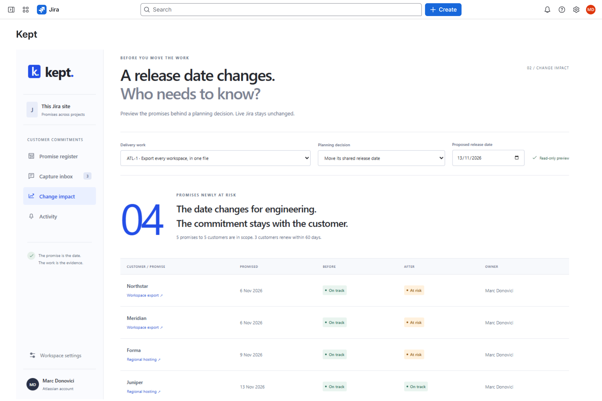 | 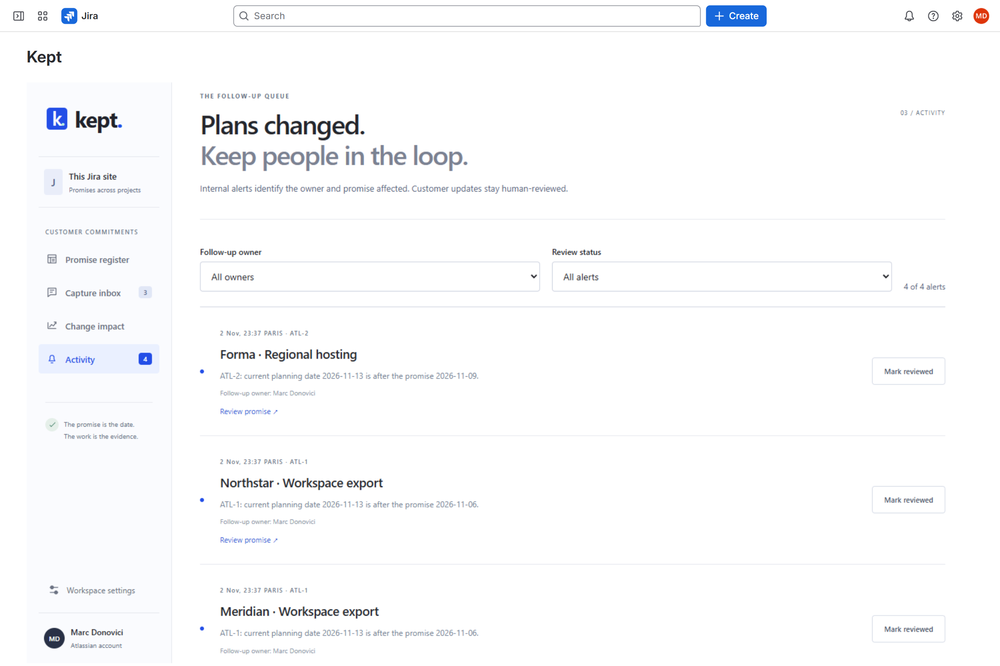 | 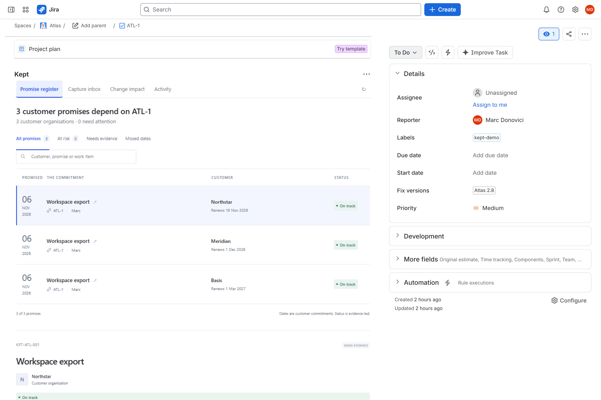 |

| Delivery evidence | Teamwork Graph sync | Workspace settings |
|---|---|---|
| 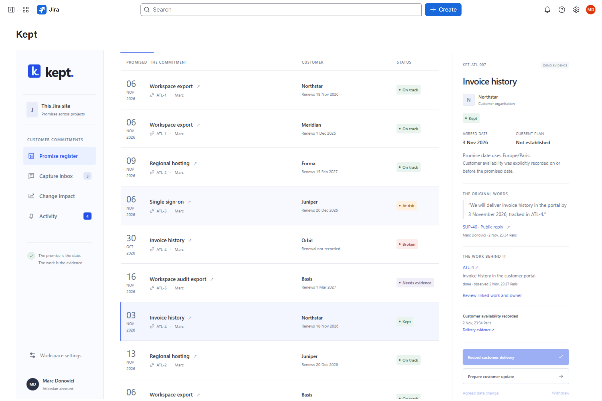 | 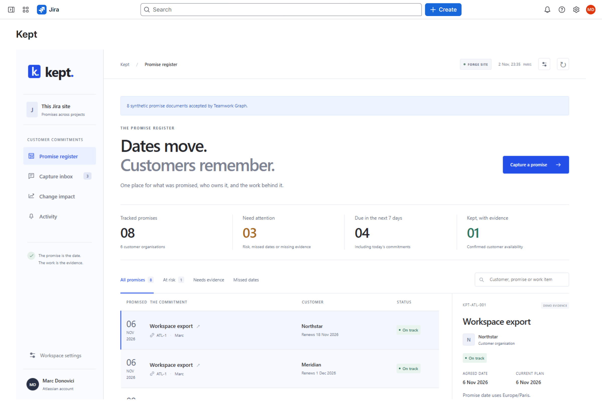 | 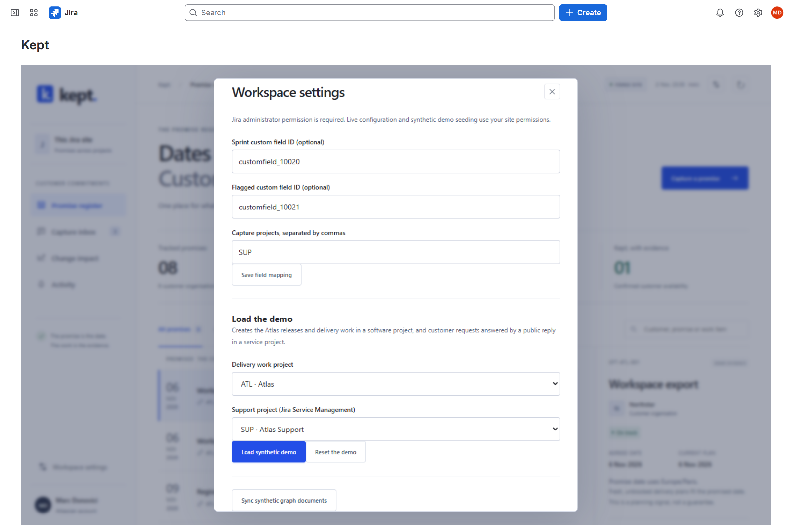 |

## The problem

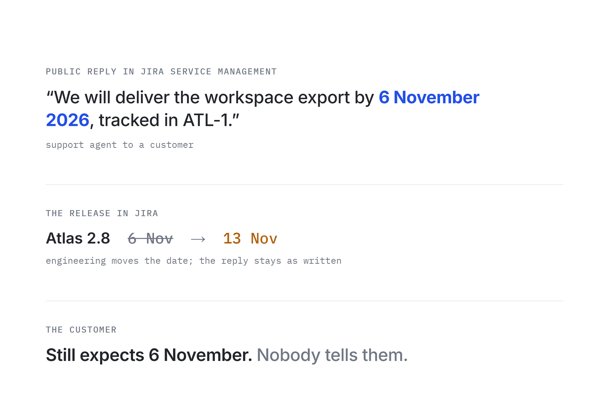

A support agent answers a customer in Jira Service Management: "We will deliver the workspace export by 6
November, tracked in ATL-1." Two days later, engineering moves the release that carries ATL-1 to 13 November. The
release lives in Jira, the promise lives in a reply, and nothing connects them. The customer finds out on 6
November.

Customers rarely hear first. In a Gartner survey of more than 6,000 customers, only 13% reported receiving any type
of proactive customer service, and proactive service results in a full point increase in Net Promoter Score
([Gartner, October 2020](https://www.gartner.com/en/newsroom/press-releases/2020-10-19-gartner-says-organizations-need-to-move-from-a-reacti)).
A later Gartner survey of more than 4,800 customers found that proactive service raises a customer's value
enhancement score by 9% ([CX Today on Gartner](https://www.cxtoday.com/loyalty-management/gartner-research-flawed-proactive-customer-service-does-more-harm-than-good)),
and that 82% of B2B customers contact the company after receiving proactive outreach
([destinationCRM on Gartner](https://www.destinationcrm.com/Articles/CRM-Insights/Insight/Consumers-Do-Contact-Customer-Service-After-Proactive-Outreach-152779.aspx)),
so the message has to say exactly which promise moved and to when.

Kept is for the support agents and customer success managers who make those promises, and the engineers whose
release dates decide whether they are kept.

## How it works

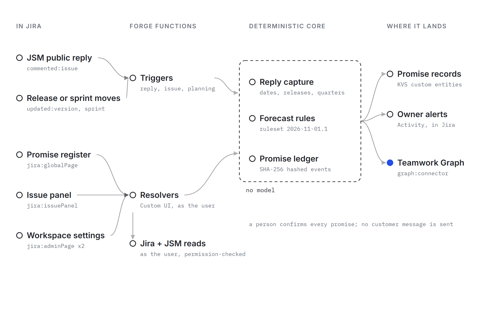

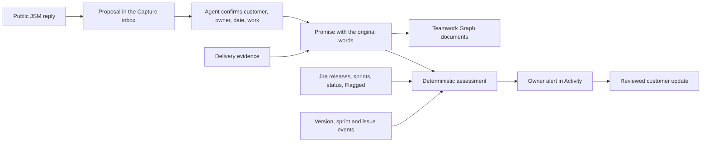

- **Captured from the agent's own words.** Public replies in the watched support projects become proposals. Kept
  checks that the comment is public and that its author is an agent (from the account type in Jira), so a
  customer's own comment never becomes a promise. A release name or a quarter in place of a date is flagged for
  review. An edited reply must be reviewed again before confirmation.
- **Tied to the work.** Each promise lists the Jira work it needs. Kept reads each item's fix version and release
  date, sprint, status and Flagged field, and assigns On track, At risk, Needs evidence, Broken or Kept, with the
  reasons.
- **Re-assessed when Jira changes.** Forge triggers on version, sprint and issue updates find the dependent
  promises, re-read the canonical work from Jira, and record an owner alert when a promise newly falls at risk.
  Repeated delivery of the same event records one alert.
- **Previewed before the move.** Change impact shows every promise sharing a release, before and after a proposed
  date, with owners and customers renewing within 60 days.
- **Closed by evidence.** Jira Done does not close a promise. Customer delivery needs a time, an evidence link and
  a note; an agreed new date keeps the original date and its outcome in the history.
- **In the graph.** The demo promises sync to Teamwork Graph through a Forge graph connector, with the customer,
  date, linked work and source link. Graph documents are workspace-visible, so promises confirmed from live customer
  replies stay in Forge storage under Jira permissions.

Code computes every proposal, state and alert. There is no model in the decision.

## How Atlassian is used

| Product | How Kept uses it | Why |
|---|---|---|
| Jira Service Management | The JSM request API reads each public reply, its visibility and author; the demo raises real requests | The promise is made in the support reply |
| Jira | `jira:issuePanel`, `jira:globalPage`, two `jira:adminPage` modules; releases, sprints, Flagged field; `mypermissions` on every read and write | The plan that decides the promise lives in Jira |
| Forge | Custom UI and resolvers as the user; triggers on `avi:jira:updated:version`, `avi:jira:released:version`, sprint, issue and comment events; KVS custom entities `promise` and `work` with conditional transactions | No server of my own; Jira's events drive the alerts |
| Teamwork Graph | `graph:connector` with a connection-change function; `setObjects` for the demo promises as `atlassian:document` objects | Customer commitments sit beside the work in the organisation's graph |

## Evidence

| Check | Result | Reproduce |
|---|---|---|
| Labelled forecast cases | 36/36: 24 written before the engine, 12 kept apart until it was complete | `npm run eval` |
| Unit tests: capture, forecast, ledger, access, Jira adapter, events, graph, drafts | 121 passing | `npm test` |
| Type check, production build, Forge manifest validation | clean | `npm run audit` |

### Run live

Production install on marc-dvci.atlassian.net, 2 November 2026: software project "Atlas" (ATL) and service project
"Atlas Support" (SUP).

| Action | Result | Time |
|---|---|---|
| Load the full demo | 8 confirmed promises across 6 organisations, 3 replies in the Capture inbox | 37.7 to 41.5 s |
| Reset the demo | Demo promises and support requests deleted | 13.4 s |
| Confirm a promise from a real JSM reply | Promise registered with its source, owner, date and work | 5.0 s |
| Preview a one-week move of Atlas 2.8 | 4 promises newly at risk, 5 customers in scope, 3 renewing within 60 days | |
| Move Atlas 2.8 to 13 November in Jira | 4 owner alerts recorded in Kept | 13.5 to 21.9 s, including page reloads |
| Open the issue panel on ATL-1 | "3 customer promises depend on ATL-1" | |
| Teamwork Graph sync | 8 demo promise documents accepted | 4.9 to 5.7 s |

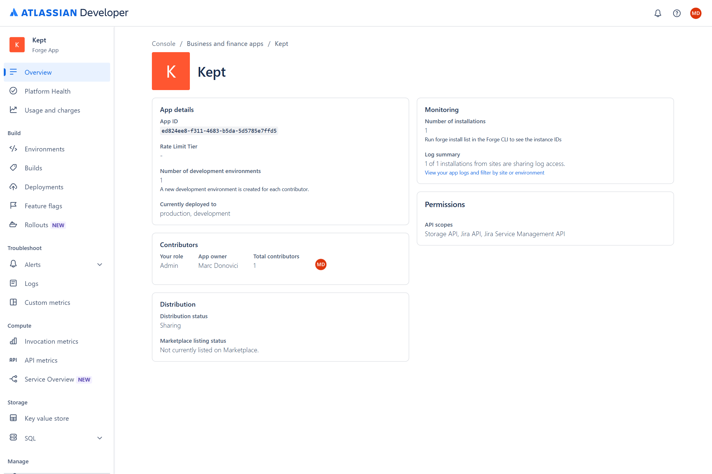

## Claims

| Claim | Code | Test |
|---|---|---|
| A customer's own comment is never a promise | `src/forge/jira.ts` | `jira.test.ts` "rejects the customer's own comment as an outgoing commitment" |
| Internal comments are refused | `src/forge/jira.ts`, `src/core/capture.ts` | "rejects an internal support reply before retaining its body", "refuses internal comments" |
| A quarter never becomes an exact date | `src/core/capture.ts` | "does not invent an exact quarter date" |
| A release without a date needs review | `src/core/capture.ts` | "requires a review for a version without a release date" |
| An edited reply gets a new fingerprint | `src/forge/jira.ts` | "retains current metadata so an edited source has a distinct fingerprint" |
| Jira Done is not delivery | `src/core/forecast.ts`, `src/core/ledger.ts` | case `done-is-not-delivery`; "requires evidence rather than a Done inference" |
| A release later than the promise means risk | `src/core/forecast.ts` | cases `late-release`, `equal-date` |
| A release move covers every item that shares it | `src/core/forecast.ts` | "includes every item sharing the changed release and counts stable customer IDs" |
| Dates end at local midnight across daylight saving | `src/core/forecast.ts` | "uses the end of the local day through daylight-saving transitions" |
| Repeated events record one alert | `src/forge/events.ts`, `src/core/ledger.ts` | "deduplicates repeat delivery but records a plan returning to a previously seen risk" |
| A delayed event never replaces newer Jira data | `src/forge/events.ts` | "does not replace a newer Jira snapshot committed during alert processing" |
| The actor comes from the Forge context | `src/forge/access.ts`, `src/core/ledger.ts` | "ignores a payload-supplied identity", "cannot choose an actor from a command payload" |
| Writes need Edit Issues | `src/forge/access.ts` | "separately checks Edit Issues permission" |
| An agreed change keeps the original date | `src/core/ledger.ts` | "retains the original commitment and customer agreement" |
| The evidence bundle verifies without the app | `scripts/verify-bundle.mjs` | "supports independent Node-only verification against a retained digest" |

## Quickstart

Install from the installation link above and follow [docs/SETUP.md](docs/SETUP.md).

To build and deploy your own copy:

```sh
npm ci
npm run audit         # type check, unit tests, forecast cases, build, manifest validation
forge register        # replaces the app id in manifest.yml
npm run deploy        # vite build + forge deploy -e production
forge install -e production
```

For an offline preview, `npm run dev` runs the same engine in the browser with the fictional Atlas team.

`src/core` holds capture, assessment, drafts and the evidence ledger; `src/forge` the platform adapters and demo
loader; `src/frontend` the app; `eval` the labelled cases. [Evidence verification](docs/EVIDENCE.md),
[privacy](docs/PRIVACY.md), [terms](docs/TERMS.md) and [sources](docs/SOURCES.md). Date recognition reads English
replies, and every proposal waits for a person to confirm it. MIT licensed.
