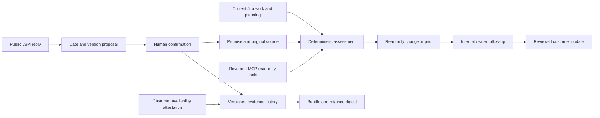

   

**Kept connects a customer promise to the Jira work that must deliver it, so the owner can review the impact before a plan changes.**

I work in technology audit. I built the register to keep the original commitment and its delivery evidence in view.

|                |                                                                                                         |
| -------------- | ------------------------------------------------------------------------------------------------------- |
| Replay         | [Open Kept](https://marc-dvci.github.io/kept/) : no account needed                                      |
| Track          | Codegeist 2026 · Apps for Business Teams                                                                |
| Working replay | TypeScript, React, Temporal, browser-local storage and Web Crypto                                       |
| Native source  | Forge, Jira/JSM, conditional storage, event triggers, Teamwork Graph, Rovo agent/skill and MCP adapters |
| Release state  | Replay available; native adapters await a billing-safe Forge installation and runtime verification      |
| Measured       | 36/36 authored synthetic forecast cases; 120 tests; 15 browser workflows                                 |

Target-platform video and the judge installation link are tracked in the [release checklist](docs/RELEASE.md).

## For judges

| Criterion                    | Evidence                                                                                                                                         |
| ---------------------------- | ------------------------------------------------------------------------------------------------------------------------------------------------ |
| Technological implementation | [Forge manifest](manifest.yml), [authenticated resolvers](src/index.ts), [native adapters](src/forge), [setup](docs/SETUP.md)                    |
| Design                       | Working desktop/mobile replay, [browser workflows](e2e/kept.spec.ts), [accessibility report](eval/reports/accessibility.json)                    |
| Potential impact             | One customer success manager, a customer commitment and a product manager moving a shared release; real-user validation remains a release task   |
| Innovation                   | Source-bound capture, retained original dates, missing-evidence states and a shared-release impact preview; [competitive scope](docs/SOURCES.md) |
| Presentation                 | Actual product screenshots, source-to-delivery workflow, [measured forecast cases](eval/reports/forecast.json) and reproducible commands         |

## See it work

1. Open **Capture inbox**. Review the public reply promising workspace export by 6 November. Confirm its customer, date, owner and delivery work.
2. Open **Change impact**. Move Atlas 2.8 from 6 to 13 November. The initial eight-promise replay identifies four affected promises and three newly at risk. Confirming the new export promise first adds one affected, at-risk promise to those totals. The customer count uses stable organisation IDs.
3. Apply the **synthetic** change. Activity contains internal alerts for the affected owners. Review a promise and prepare its customer update.
4. Record when the promised outcome was available to the customer, with a source URL and reviewed evidence. Jira Done alone cannot make a promise Kept.
5. Record an agreed amendment. The original date stays in the history. Export the full evidence bundle and retain its digest separately.

Use **Missed dates** for overdue promises. In **Activity**, filter by follow-up owner and review status. Customer drafts can be edited before copying; internal evidence references remain outside the message.


## The problem

A customer success manager has a renewal call tomorrow. Engineering is moving a release today. The support reply, customer context and delivery plan live in different places, so the manager needs a precise answer: what did this customer hear, what work does it depend on, and what changed?

Kept makes that a record. A proposed date requires confirmation. The original reply, date, timezone, customer identifier and owner remain attached to the work. Missing planning evidence stays visible. A new plan keeps the customer commitment fixed.

## How it works



Code proposes dates and computes risk. A person confirms the promise, records actual customer availability and reviews communication.

The forecast uses all required work items, their current release/sprint bounds, blocked state and observation age. A future plan beyond the commitment is **At risk**. A missed deadline without timely availability is **Broken**. **Kept** requires explicit delivery evidence. Incomplete or stale observations are **Needs evidence**. Withdrawal retains its evidence and original outcome.

## Atlassian integration

| Capability                       | Purpose in the implementation                                                                                         |
| -------------------------------- | --------------------------------------------------------------------------------------------------------------------- |
| Jira panel and global page       | View promises from their source request or delivery work, or review the accessible population                         |
| JSM public comments              | Re-read source visibility, body and current metadata before confirmation; reject internal/customer-originated sources |
| Current-user Jira API            | Check source and every required work item, read current plans, validate owners and require Edit Issues for writes     |
| Forge storage                    | Version-conditional promise writes, full event snapshots and indexed work-to-promise references                       |
| Issue, version and sprint events | Re-read canonical planning data and record deduplicated in-app owner alerts                                           |
| Teamwork Graph connector         | Project synthetic promise documents with source links; refuse real-customer workspace-wide ingestion                  |
| Rovo agent and reusable skill    | Explain evidence and prepare reviewed follow-up using read-only actions                                               |
| MCP                              | Read a customer's promises, inspect evidence and preview a release move; no writing or sending tool                   |

The adapters are implemented and schema-validated. Their actual permission, event, graph, agent and installation behaviour still needs the protected-site checks in [RELEASE.md](docs/RELEASE.md).

## Review and evidence

Every confirmed promise retains its source snapshot. A source edit invalidates an unconfirmed proposal's fingerprint. Relative dates in edited replies require review. Date changes require customer agreement evidence, and the original date remains visible. Withdrawal also needs its own agreement and rationale; it cannot turn an already missed original obligation into a kept promise.

Confirmation exposes the full public-reply snapshot retained in the record. Incomplete planning evidence stays explicit in customer drafts. Conflicting metadata for the same customer ID makes renewal totals uncertain. Native reply discovery is paged, with expiring references and direct loading for older comments.

The evidence bundle contains full event snapshots, the current record and delivery observations. A [separate Node verifier](scripts/verify-bundle.mjs) can compare its digest with an independently retained value. Hashes check consistency; source truth and account authority require their underlying controls.

## Measurements

| Check                        | Result                                                                   | Reproduce              |
| ---------------------------- | ------------------------------------------------------------------------ | ---------------------- |
| Forecast corpus              | 36/36 authored synthetic cases: 24 primary plus 12 secondary             | `npm run eval`         |
| Domain and adapter contracts | 120 passing tests                                                         | `npm test`             |
| Browser workflows            | 15 passing workflows                                                     | `npm run test:browser` |
| Accessibility                | No axe-core A/AA violations in four sections and eight action dialogs | `npm run test:browser` |
| Mobile                       | No page overflow at 390 px in each section; settings and reset work      | `npm run test:browser` |
| Dependency security          | Zero known advisories in the saved locked-dependency audit               | `npm audit`            |
| Build and Forge schema       | Strict TypeScript, production build and offline manifest validation pass | `npm run audit`        |

The primary cases were committed before the engine. The secondary cases were authored before implementation, retained separately and first executed after the engine was built. Both are authored conformance sets, not an independent blind accuracy study. The report records case hashes. No measured time saving, churn reduction, customer adoption or production SLA is claimed.

## Claims map

| Claim                                                     | Code                                        | Test                                         |
| --------------------------------------------------------- | ------------------------------------------- | -------------------------------------------- |
| Jira Done does not prove customer availability            | `src/core/forecast.ts`                      | `done-is-not-delivery`                       |
| A moved plan implies risk before the deadline             | `src/core/forecast.ts`                      | `late-release`, `equal-date`                 |
| A preview preserves stale evidence age                    | `src/core/forecast.ts`                      | Stale blocked-evidence regression            |
| Shared release impact includes every observed linked item | `src/core/forecast.ts`                      | `forecast.test.ts`                           |
| Original dates and agreement evidence remain              | `src/core/ledger.ts`                        | `ledger.test.ts`, browser amendment workflow |
| Public source text cannot choose the actor                | `src/forge/access.ts`, `src/core/ledger.ts` | Identity and command-attribution tests       |
| API outages cannot look like a healthy empty population   | `src/forge/access.ts`, `src/forge/jira.ts`  | Permission/outage and property-source tests  |
| A stale browser session cannot overwrite a record         | `src/frontend/client.ts`                    | Two-page browser workflow                    |
| Real customer promises cannot enter the synthetic graph   | `src/forge/graph.ts`                        | `graph.test.ts`                              |
| Registration and metered deployment stay blocked          | `src/core/cost-policy.ts`                   | `cost-policy.test.ts`                        |
| Repeated sprint/release risks remain distinct from duplicate event delivery | `src/forge/events.ts` | `events.test.ts` |
| Evidence actions preserve the correct fields and attribution | `src/core/transitions.ts`, `scripts/verify-bundle.mjs` | `evidence-boundaries.test.ts` |
| A partial plan cannot become a confident customer draft | `src/core/draft.ts` | `draft.test.ts` |
| Damaged replay metadata can be downloaded and reset | `src/frontend/client.ts` | Browser recovery workflow |

All replay customers, people, source replies, work and availability evidence are fictional. The shared decision code is real; native runtime evidence remains a release gate.

## Quickstart

```sh
npm ci
npm run dev
# http://127.0.0.1:4185
npm run audit
npm run test:browser
```

See [setup](docs/SETUP.md), [evidence verification](docs/EVIDENCE.md), [privacy](docs/PRIVACY.md), [terms](docs/TERMS.md) and [cost controls](docs/COSTS.md).

`src/core` contains capture, assessment and evidence logic; `src/frontend` contains the desk and replay store; `src/forge` contains platform adapters; `eval` contains the authored cases and results. `manifest.yml` declares Forge infrastructure. The source is MIT licensed.

English proposal recognition is bounded and requires human confirmation. Forecasts cover visible managed promises and depend on current configured observations. Follow-up alerts are in-app; there is no unattended deadline sweep or external communication. Production identity, retention, load testing, Marketplace review, live installation and target-platform film are tracked in the [release checklist](docs/RELEASE.md).
